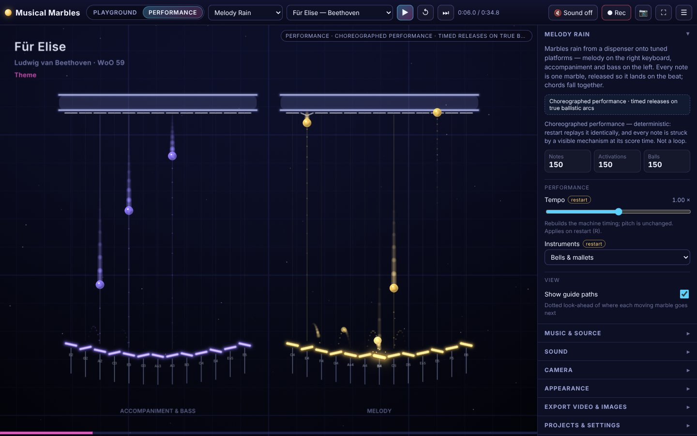
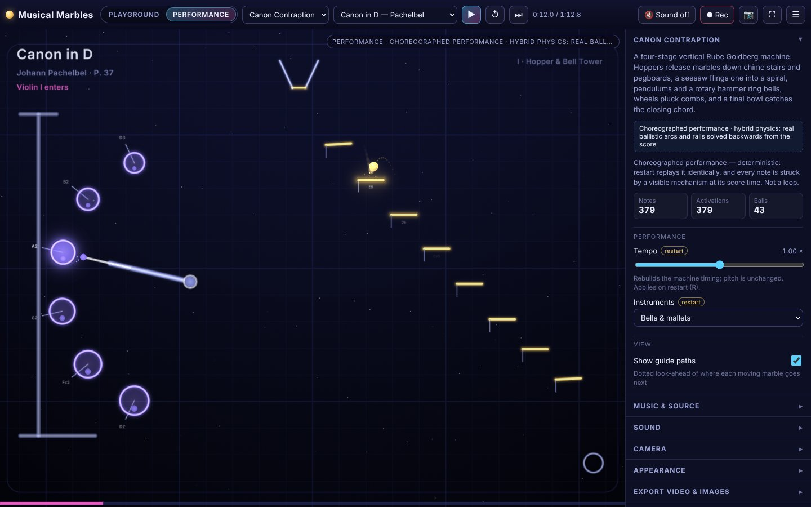
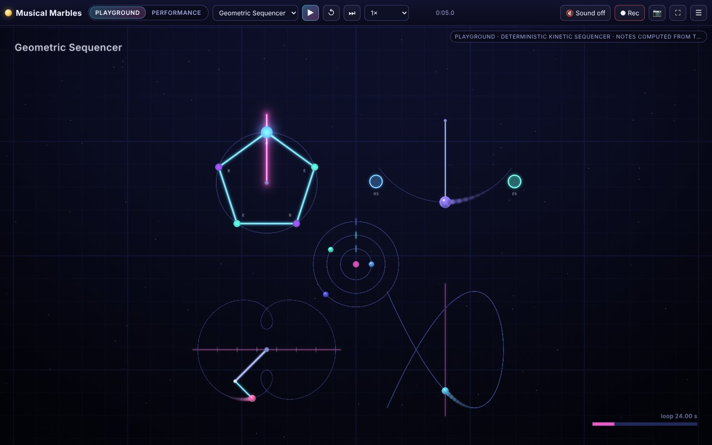
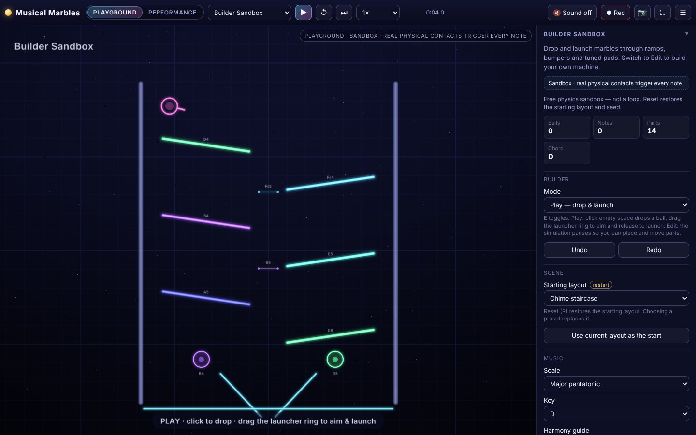

<p align="center">
  
</p>

# Musical Marbles

A browser-based audiovisual playground and video studio: marbles, machines and music.



## Screenshots

| | |
|---|---|
|  |  |
| **Canon Contraption** (Performance) | **Geometric Sequencer** (Playground) |
|  | |
| **Builder Sandbox** (Playground) | |

Captured from `npm run dev` in headless Chromium with the built-in demo scenes and songs. The app
has a single dark look, so there are no light-mode shots.

## What's inside

- **Playground**: free physics where real contacts make the sound: a builder sandbox with
  ramps, walls, bumpers, funnels, musical pads and note gates; a growing ball; a collision
  cascade; a deterministic geometric sequencer; and a Shepard-tone illusion lab.
- **Performance**: five families of kinetic machines that visibly perform short excerpts of
  public-domain classical pieces, every note struck by a mechanism at its score time.
- **Studio**: record the canvas plus the generated audio to a video file at exact export
  sizes, or save PNG screenshots.

Everything runs locally in the browser: no backend, accounts, analytics, network audio,
microphone or camera. All sound is synthesised live with the Web Audio API.

---

## Install

**Use it in the browser:** https://harrisonfischberg.github.io/musical-marbles/ (every push to `main` is tested, built with Vite and published by `.github/workflows/pages.yml`).

There is nothing to install for that. To run it yourself you need Node.js **22.18 or newer**
(the build scripts are TypeScript run directly by Node) and a browser with WebGL.

### Run it locally

```bash
git clone https://github.com/HarrisonFischberg/musical-marbles.git
cd musical-marbles
npm install
npm run dev        # then open the address it prints (usually http://localhost:5173/)
```

Musical Marbles was previously called *Kinetic Score*. Settings, saved projects and exported
JSON files from that name still load (they are migrated to the new `musical-marbles/…` ids).

### Normal setup (Vite)

```bash
npm install
npm run dev        # dev server with hot reload
npm run build      # typecheck + production build into dist/
npm run preview    # serve dist/
npm test           # unit tests (Node's built-in test runner)
npm run typecheck
```

three.js is vendored in `vendor/three` (r186, MIT), so `npm install` only fetches Vite,
TypeScript and Node type definitions.

### Zero-dependency path

There is also a build that needs nothing but Node and the TypeScript compiler (useful offline;
it was the first build verified while npm was unavailable):

```bash
node scripts/build-static.ts   # TypeScript → native ES modules + import map in dist-static/
node scripts/serve.ts          # http://localhost:5180/
```

`dist-static/` is a plain static site; host it anywhere (it must be served over HTTP, not opened
as a file, because the app fetches its score data and uses ES modules).

Other scripts: `node scripts/build-scores.ts` regenerates `public/scores/*.json` from the MIDI
sources; `node scripts/inspect-midi.ts <file.mid> [track]` prints a MIDI summary;
`node scripts/browser-check.ts` runs the headless-browser checks (needs the `playwright`
package and a Chromium build, not project dependencies).

---

## Dark mode

Musical Marbles is dark only. The page declares `color-scheme: dark`, the interface uses a
fixed night palette, and it does not follow your system's light or dark setting. You can change
the look of the canvas under **Appearance → Palette** (Neon night, Aurora, Ember, Ice, Ink on
night); every palette is dark.

---

## Using it

Open the page: a silent preview of Melody Rain runs behind a start card. Nothing
makes a sound until you press **Enable audio & start** (or later, **Sound off** in the header).

| Action | How |
|---|---|
| Play / pause | **Space** or ▶ |
| Restart from the top | **R** or ↺ |
| Single step while paused | **.** or ⏭ |
| Show / hide the control panel | **H** or ☰ |
| Clean view (hide all chrome) | ⛶ — leave with **Esc** |
| Zoom / pan | wheel or pinch; right-drag (or two fingers) to pan; Camera panel → Overview / Follow / Reset |
| Builder: drop a ball | click or tap empty space (Play mode) |
| Builder: aim and launch | drag from the launcher ring and release (power = drag length) |
| Builder: edit | **E** toggles Edit mode (simulation pauses); pick a tool, drag to draw ramps/walls/pads/gates, click for bumpers/funnels; drag parts or their end handles; **Delete** removes; **D** duplicates; **Ctrl+Z / Ctrl+Shift+Z** undo/redo |

Shortcuts are ignored while typing in a text field.

Controls marked **restart** (song, tempo, instruments, starting layout, seed…) take effect when
the scene restarts; everything else applies immediately.

### Playground scenes
- **Builder Sandbox** — presets *Chime staircase*, *Bumper garden*, *Sequencer run*, *Blank*.
  Musical parts (pads, gates, bumpers) have pitch (scale degree), instrument, velocity
  sensitivity, retrigger mode (cooldown / once per ball visit / every contact), optional chord
  and sequence advancement. Global: scale, key, gravity, bounciness, friction, ball radius,
  launch speed, auto-spawn rate, ball cap, ball–ball collisions, clear balls.
- **Harmony guide** (Builder and Collision Cascade, under Music/Sound) — keeps random collisions
  musical. Notes follow a chord progression in the chosen key (*Bright* I–V–vi–IV by default,
  *Calm*, *Dreamy* or one chord; chord changes every 4 s by default; the current chord is shown
  in the counters). **Melody** mode (default): each hit moves at most a fifth from the previous
  note, leaning toward the pitch of the part that was hit, so hits form a connected line.
  **Chords** mode: each hit snaps to the nearest chord tone. **Off**: raw pitches as before.
  Hits beyond *Notes allowed at once* (3 within ~0.1 s) stay silent but still flash. In the
  Cascade, wall hits play a bass line and ball–ball hits play the melody over the same chords.
- **Growing Ball** — each wall impact grows the marble, steps its melody, lowers its register,
  crossfades its timbre and pulses the arena; at a safe size limit it resolves with a chord and
  a new marble starts.
- **Collision Cascade** — wall hits (low register) and ball–ball hits (high register) spawn
  new marbles under per-ball cooldowns, a generation limit, overlap-free spawning, a population
  cap, a notes-per-second budget and lifetime recycling.
- **Geometric Sequencer** — rotating polygon, pendulum, two-rod linkage, Lissajous path and
  orbiting moons. Notes come from geometry events (vertex crosses the play line, pendulum
  endpoint, linkage tip crosses the staff line, Lissajous dot crosses the centre line, orbit
  completes a turn) and are scheduled on the audio clock. With rational period ratios it is an
  exact **seamless AV loop**; the *One seamless loop* export take records the second cycle so
  ringing tails match at the seam.
- **Shepard-Tone Lab** — continuous or collision-stepped Shepard tone; rising/falling, rate,
  layers, range, brightness, level; a pitch-helix and spectrum-window visualisation.

### Performance scenes (choreographed)
Motion in Performance mode is **hybrid choreographed physics**: marbles fly real ballistic arcs
(constant gravity) and ride rails, but the arcs, releases and ring rotations are *solved
backwards from the score* so every contact lands on its note. The app says so in each scene.

| Scene | Built around | Mechanisms |
|---|---|---|
| **Canon Contraption** (flagship) | Pachelbel, Canon in D | Four stacked stages + finale bowl: hopper release gates, chime stairs, rotary bell hammer & bell tower, paddle wheel, tuned pegboard, seesaw launcher (tipped by a messenger marble), guided spiral, drip hoppers, pendulum hammers, funnel, branching accompaniment lane, pin wheel, final bowl. Camera follows stage by stage. |
| **Melody Rain** | Beethoven, Für Elise | Timed drops from a dispenser rail onto two tuned keyboards (melody / accompaniment); chords fall together. |
| **Musical Maze** | Mozart, Rondo alla turca | Two seeded perfect mazes; marbles tour every corridor at constant speed through note gates; timed doors open only as a marble passes. |
| **Orbital Classics** | Bach, Prelude in C (BWV 846) | Zero-gravity straight runs between rim chimes in three disjoint sectors (marbles never cross); repeats glance off the equator deflector. A separate **Sandbox** mode turns the same arena into free physics where marbles grow on impact (interpretive: the song's pitches, not its rhythm). |
| **Ring Escape** | Grieg, Hall of the Mountain King | Each phrase is a marble fired from the core through rotating rings; ring rotation is solved so each real gap meets the marble on its note; energy rises with the accelerando; bass on pendulum hammers. |

**Ode to Joy** works in every scene (it is the cross-scene test piece). Song/scene combinations a
family cannot perform plausibly are disabled in the Song menu with the computed reason — e.g.
Orbital Classics rejects pieces whose leaps would need implausible marble speeds, and Ring Escape
rejects pieces whose notes are too close together for ring crossings.

---

## Architecture

```
src/
  app/            App shell (chrome, frame loop, scene switching, recording flow, persistence UI), scene registry
  simulation/     Deterministic 2D physics (circles vs segments/circles/arcs, kinematic bodies, sensors), fixed-step stepper
  choreography/   Performance primitives (ballistic/path/knot segments, activations, validation) and the mechanism library
  scenes/         builder/ (sandbox + layouts + presets), generative/ (growing, cascade, sequencer, Shepard), performance/ (five families)
  music/          MIDI parser, score model/validation/timing, scales, bundled library
  audio/          AudioEngine (voices, buses, limiter, recording tap), instruments, Shepard engine
  transport/      Transport clock + lookahead event scheduler
  rendering/      Three.js renderer, instanced SDF shape batch, draw list, glyph atlas, camera, palettes, effects
  recording/      MediaRecorder wrapper with runtime MIME detection
  settings/       Versioned settings/project schema, validation, safe storage
  ui/             DOM helpers, generic parameter controls, CSS
public/scores/    Generated, inspectable score JSON (one file per excerpt)
score-src/        Mutopia MIDI sources (and one LilyPond file)
scripts/          build-scores, inspect-midi, build-static, serve, browser-check, capture
tests/            Node test runner suites
vendor/           three.js build + type definitions (MIT)
```

Key ideas:
- **One transport.** The transport position is derived from the AudioContext clock once audio
  runs (performance.now before), re-anchored on every play/pause/seek, so pausing never drifts.
  Performance scenes render as a pure function of that position; audio events are scheduled
  ~150 ms ahead at exact clock times. Pause cancels unstarted notes and rewinds the cursor, so
  resuming never duplicates or reorders notes. Visuals are offset by the device output latency in
  preview (not while recording, because the file has no device latency).
- **Activations are the single source of truth.** Each performance family turns the score into
  activations (time, notes, visible target). Audio events *are* the activations, and the props
  flash from the same list, so every audible note has a visible strike and vice versa. Tests check
  the 1:1 mapping for every family × song × tempo.
- **Physical plausibility is checked, not assumed.** Bounce chains are constrained so every pad is
  approached and left like a real reflection; the maze doors are open whenever a marble passes;
  ring gaps are checked to contain the marble for the whole time it is inside the ring's band;
  speeds are bounded; there are no position jumps (teleports).
- **Rendering** is one instanced quad per primitive with signed-distance shading (marbles,
  glowing capsules, arcs, glyphs, rounded rects, sparks) in four layers (trails, main, glow, HUD),
  plus a background shader. No per-frame geometry is rebuilt; batches grow to a hard cap.
  Trails are time-based; performance trails and sparks are computed from time (deterministic).
- **Physics** uses a fixed 120 Hz step, an accumulator with a catch-up cap, substeps sized from
  the fastest ball, penetration correction, contact-entry events with hysteresis (resting balls do
  not retrigger), sensors, kinematic colliders, seeded randomness and pooled balls.

## Sound

One AudioContext, created on the first user gesture. Six synthesised voices — **bell** (additive,
inharmonic partials), **glass chime**, **marimba pluck**, **warm pluck** (filtered triangle),
**arcade tone** (filtered square) and **sustained voice** (detuned saws, vibrato, held for the
note length). Routing: voice → per-instrument bus (volume) → master → glue compressor → peak
limiter → speakers, plus a parallel tap to a MediaStreamDestination for recordings, and a subtle
synthetic room send (Ambience). A 40-voice limit steals the oldest voice. Mechanical contacts in
the playground make quiet filtered-noise ticks (its own volume). **Mute** silences the speakers
only; recordings still contain the mix.

The Shepard engine uses N octave-spaced layers sharing one phase; each layer's loudness is a
raised-cosine window over log-frequency that is exactly zero where a layer wraps, and the window
sum is constant (N/2), so the total level never pumps. Each layer sits at (i + unwrapped phase) mod N
octaves, so layers glide continuously and only the silent top layer ever jumps to the bottom. The
tone is synthesised sample by sample in an AudioWorklet (phase, window and oscillator phase per
sample — nothing stepped at the frame rate); if AudioWorklet is unavailable (e.g. a plain-http LAN
address) it falls back to per-frame oscillator automation. Tests check octave spacing, the window,
constant level, per-layer continuity across phase wraps and the worklet's own output. An offline
spectral-flux comparison of the worklet output showed no spikes at the wraps (max 2.5× the median
frame-to-frame change), whereas reintroducing the old per-octave layer re-indexing produced
13.7× spikes — the "zip" reported in real use and fixed in iteration 15. Whether the illusion is convincing depends on ears and
speakers; it was **not** auditioned in this build environment.

## Recording & export

- Frames: **portrait 720×1280 / 1080×1920, square 720×720 / 1080×1080, landscape 1280×720 /
  1920×1080**. The preview's CSS size, the canvas backing resolution and the device pixel ratio
  are separate: during a take the canvas renders at the exact export size (the preview is
  letterboxed to match), then returns to the preview size.
- 30 or 60 fps (if the browser keeps up). Takes: manual start/stop, timed, *whole performance
  from the start* (resets, records, auto-stops after the final note plus a decay tail), and *one
  seamless loop* for the sequencer. Optional 3-2-1 countdown (not recorded).
- What is captured: the WebGL canvas (glow, trails, particles, camera, title/counter overlays are
  all rendered into it) and the generated audio. Never the DOM, microphone or camera.
- Format: chosen at runtime with `MediaRecorder.isTypeSupported` — MP4 (H.264/AAC) when the
  browser offers it, otherwise WebM (VP9 or VP8 + Opus). The file extension always matches the
  MIME type actually produced; MP4 is never promised when only WebM is available.
- Real-time capture can drop frames on a busy machine; it is not frame-perfect.
- If MediaRecorder or canvas capture is missing, the app says so and everything else still works.
- PNG screenshots render a fresh frame (at the export size when the export frame preview is on).

Settings that would invalidate a take (scene, song, tempo, export size…) are locked while
recording. Object URLs of previous takes are released after the new take is ready.

## Projects & settings

Settings (appearance, sound, export, seed, per-scene values, the builder layout) persist in
`localStorage` when available. **Projects & settings** lets you save named projects, copy a
project as JSON (with a textarea fallback when the clipboard is blocked) and import pasted JSON.
Imports are parsed and validated field by field against a versioned schema
(`musical-marbles/project@1`, `musical-marbles/settings@1`, `musical-marbles/layout@1`); invalid
fields are dropped with a message and nothing is ever executed. Storage failures (private mode,
quota) are reported and the app keeps working.

---

## Music sources & rights

Note data comes from **Mutopia Project** MIDI files, which Mutopia renders from its LilyPond
typesettings of public-domain editions. `scripts/build-scores.ts` turns them into the
inspectable JSON in `public/scores/` (each file records the source, licence, edition, the exact
excerpt range and every arrangement change). Excerpts are original simplified arrangements:
passages were selected, notes assigned to melody / counter / accompaniment / bass, very short
ornaments that a mechanism cannot articulate removed, and in two cases a closing chord added.

| Piece | Excerpt | Mutopia entry | Edition (as listed by Mutopia) | Licence of the typesetting |
|---|---|---|---|---|
| Pachelbel — Canon in D (P. 37) | bars 1–16 + closing chord | [#2047](https://www.mutopiaproject.org/cgibin/piece-info.cgi?id=2047) | "IMSLP" (no specific edition named) | **CC BY 4.0** — attribution: typeset by the Mutopia Project contributors (see the entry for the typesetter) |
| Beethoven — Für Elise (WoO 59) | A section with repeat | [#931](https://www.mutopiaproject.org/cgibin/piece-info.cgi?id=931) | Breitkopf & Härtel, 1888 | Public Domain |
| Beethoven — Ode to Joy (Sym. 9 theme, hymn setting) | complete 16-bar theme | [#528](https://www.mutopiaproject.org/cgibin/piece-info.cgi?id=528) | "Various" | Public Domain |
| Mozart — Rondo alla turca (K. 331/III) | bars 1–48 | [#108](https://www.mutopiaproject.org/cgibin/piece-info.cgi?id=108) | "IMSLP" | Public Domain |
| Bach — Prelude in C (BWV 846) | bars 1–19 + closing chord | [#5](https://www.mutopiaproject.org/cgibin/piece-info.cgi?id=5) | "Unknown" | Public Domain |
| Grieg — In the Hall of the Mountain King (Op. 46/4, piano) | bars 1–25, transposed up 2 octaves, accelerando added | [#1888](https://www.mutopiaproject.org/cgibin/piece-info.cgi?id=1888) | The University Society, 1918 | Public Domain |
| Mozart — Eine kleine Nachtmusik (K. 525/I) | bars 1–18 | [#900](https://www.mutopiaproject.org/cgibin/piece-info.cgi?id=900) | "IMSLP" | Public Domain |
| Bach — Brandenburg Concerto No. 1 (BWV 1046/I) | bars 1–12, four-part reduction | [#1136](https://www.mutopiaproject.org/cgibin/piece-info.cgi?id=1136) | Bach-Gesellschaft vol. 19, ed. Rust, 1871 | **CC BY 3.0** — attribution as above |

Honest caveats: where Mutopia lists the source only as "IMSLP", "Unknown" or "Various", no
specific printed edition is identified. The compositions are centuries old and public domain, but
rights in editions and typesettings vary by country; this list is a good-faith record of sources,
**not a worldwide clearance**. The Ode to Joy data is a four-part hymn setting of Beethoven's
theme, not the symphony's orchestration.

**Not available:** Beethoven's *Moonlight* Sonata (I) and Vivaldi's *Spring* (I). The only
machine-readable typesettings found (Mutopia #276 and #301) are licensed CC BY-SA (share-alike),
and no verified public-domain or attribution-only note data was available, so they appear in the
app as disabled with that reason rather than being reconstructed from memory.

**Importing a score (optional):** in a performance scene, *Music & source → Import a score*
accepts a `musical-marbles/score@1` JSON object (same shape as the files in `public/scores/`). It is
validated field by field as plain data (never executed), renamed `import-…`, offered in the Song
menu for this session only, and you are responsible for the rights to what you import. MIDI import
is not offered in the app (the bundled `scripts/build-scores.ts` shows how MIDI was converted).

Third-party code: three.js r186 and its type definitions (MIT, vendored in `vendor/`).

---

## Testing & verification

- `npm test` — 105 Node tests: score validation (incl. hostile input), recognisable openings,
  timing/grouping/tempo ramp, every performance family × supported song × tempo 1.0 and 0.8
  (1:1 note↔activation mapping, visible target for every activation, no teleports, bounded
  speed, contact on time, physically valid bounces, ring gap clearance, door timing), physics
  determinism and tunnelling, contact retrigger suppression, sensors, stepper catch-up cap,
  safe spawning, transport pause/seek/rate/clock switch, scheduler pause/resume without
  duplicates (incl. an event exactly at the pause instant), Shepard octave spacing, window,
  level and phase continuity, settings/project/layout validation, sequencer loop length, MIDI
  parsing.
- `node scripts/browser-check.ts` — headless Chromium (software WebGL, fake audio device),
  including an analysis of recorded takes: note onsets decoded from the files match the score
  with ~1.5 ms median jitter, and the pitches detected in the files are exactly Für Elise's
  opening motif, the Ode to Joy melody and the Canon's ground bass. See
  [docs/VERIFICATION.md](docs/VERIFICATION.md) for the list, the latest results and the manual
  checklist for things that need real eyes, ears and devices.

## Known limitations

- Both `npm run build` (Vite) and the zero-dependency build were verified, in headless Chromium
  only (software rendering, virtual audio output). Safari and
  Firefox, real GPUs, real speakers and touch devices have not been exercised in this
  environment; see the manual checklist.
- Recording produced WebM in the test browser (it has no H.264 encoder); MP4 depends on the
  browser.
- Choreographed performances are deterministic animations solved from the score, not free
  physics simulations; the Playground scenes (and Orbital Classics' Sandbox mode) are the
  free-physics part.
- Very fast passages are excluded from some scenes rather than shown implausibly (see the Song menu).

---

Made by [Rare Creatures LLC](https://rarecreatures.app). Questions or feedback:
[hello@rarecreatures.app](mailto:hello@rarecreatures.app).
